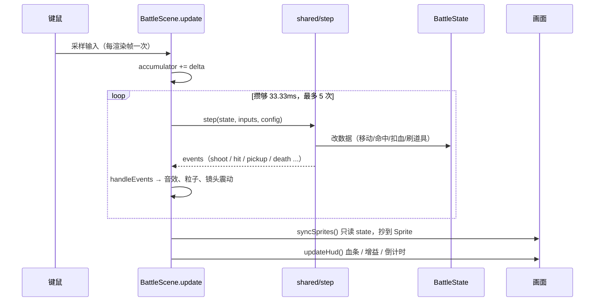
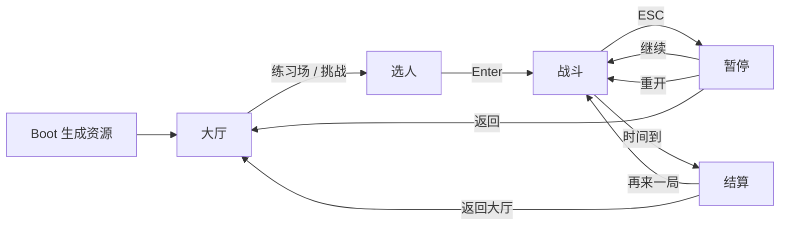
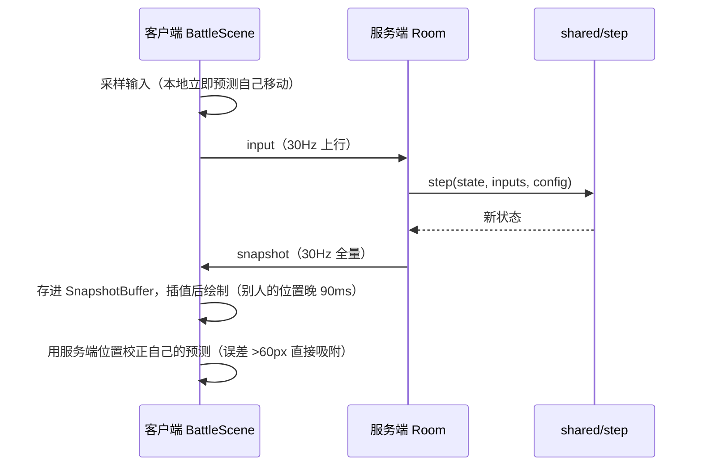

# 代码地图

> 这份文档不属于上游 `docs/` 里的四份设计文档（需求 / 技术方案 / 开发约定 / 美术规范），
> 它是**实现说明**：告诉你代码放在哪、每个文件干什么、想改某个东西该动哪里。
> 四份设计文档回答"做什么、为什么这么做"，这份文档回答"代码在哪"。
>
> 最后更新：2026-11-17

---

## 1. 三十秒看懂

一句话：**一份纯数据的"世界状态" + 一个固定步长的推进函数 + 一层只负责画它的 Phaser 场景。**

```
键盘鼠标  ──▶  PlayerInput  ──▶  step(state, inputs, config)  ──▶  BattleState（唯一真相）
                （意图）              （纯 TS，不认识 Phaser）         （谁在哪、剩多少血、有几颗子弹）
                                                                        │
                                                                        ├──▶ 渲染层只读它，画成画面
                                                                        └──▶ 事件队列：音效 / 粒子 / 结算
```

为什么要这么分：

- **`shared/` 不认识 Phaser**，所以同一份逻辑将来能直接搬到服务端跑（联机时服务端才是权威）；
- **渲染层只读不写**，所以"画错了"不会污染"判定"，调试时两边可以分开查；
- **逻辑帧固定 30Hz**，与显示器刷新率解耦，低配机器不会"玩得快一点或慢一点"。

---

## 2. 目录地图

```
d:\TDA
├─ package.json              根脚本（dev / build / test / typecheck / lint / format）
├─ tsconfig.base.json        公共 TS 配置（strict，被下面两个 tsconfig 继承）
├─ .prettierrc.json          代码格式规则
├─ .prettierignore
├─ shared/                   ⭐ 纯 TS 战斗逻辑（禁止 phaser / ws / node / DOM）
│  ├─ tsconfig.json          单独一份配置：lib 只有 ES2022，不含 DOM
│  └─ src/
│     ├─ types.ts            所有数据结构与事件类型
│     ├─ world.ts            创建世界、地图墙体、重生
│     ├─ step.ts             固定步长推进（整个游戏唯一的"战斗逻辑入口"）
│     ├─ index.ts            shared 对外出口（client 只从这里 import）
│     ├─ content/            ⭐ 可玩内容：角色 Character / 地图 GameMap + 注册表
│     ├─ ai/                 ⭐ 单人模式 AI 对手（只产出 PlayerInput，不碰判定）
│     ├─ config/             数值配置（角色表由 content/ 派生）
│     └─ sim/                具体规则：移动、命中、伤害、道具
├─ client/                   Phaser 4 客户端（渲染 / 输入 / 音频 / 场景）
│  ├─ index.html             画布容器、昵称输入框、页面样式
│  ├─ vite.config.ts         Vite 配置（root=client，别名 @shared → ../shared/src）
│  ├─ tsconfig.json          客户端 TS 配置（含 DOM 库、@shared 路径映射）
│  └─ src/
│     ├─ main.ts             创建 Phaser.Game、注册场景、整数倍缩放
│     ├─ scenes/             各个界面（大厅 / 选人 / 战斗 / 暂停 / 结算）
│     ├─ assets/             真实素材加载 + 素材清单（文件名 → 贴图/音频 key）
│     ├─ input/              键鼠 → PlayerInput
│     ├─ render/             占位贴图、整数倍缩放
│     └─ audio/              程序化合成音效 + 2D 定位播放
├─ assets/                   ⭐ 素材目录（改图改音只动这里）
│  ├─ README.md              改图改音指南（文件名、尺寸、时长、FAQ）
│  ├─ images/                图片成品（PNG），缺失时回退占位图
│  └─ audio/                 音频成品（.ogg / .mp3），缺失时回退合成音
├─ scripts/
│  └─ check-shared-boundaries.mjs   lint:boundary：检查 shared/ 没有违规依赖
├─ dist/                     构建产物（不入库）
└─ docs/
   └─ code-map.md            本文件
```

---

## 3. `shared/` 逐文件说明

### 3.1 根目录

| 文件       | 作用                                                                                                                                                                                      | 你什么时候会改它                             |
| ---------- | ----------------------------------------------------------------------------------------------------------------------------------------------------------------------------------------- | -------------------------------------------- |
| `types.ts` | 定义所有数据结构：`BattleState`（世界）、`PlayerState`（角色）、`BulletState`（子弹）、`PickupState`（地面道具）、`PlayerInput`（输入意图）、`BattleEvent`（事件）、`PlayerScore`（战果） | 加一种新东西进世界（比如符卡、障碍物类型）时 |
| `world.ts` | `createBattleState()` 造一局；`buildMapWalls()` 把瓦片配置变成碰撞矩形；`respawnFighter()` 复活                                                                                           | 改出生点逻辑、加新的初始化内容               |
| `step.ts`  | **核心**：推进一帧。顺序是 增益倒计时 → 移动 → 瞄准 → 回盾 → 开火 → 子弹推进与命中 → 道具刷新/拾取 → 清理                                                                                 | 想改"每帧的计算顺序"或加新的每帧规则         |
| `index.ts` | 对外出口。客户端只从 `@shared` 导入，不直接深挖子路径                                                                                                                                     | 新文件要让客户端用，就在这里导出             |

### 3.2 `content/`（可玩内容：加角色 / 加地图只动这里）

| 文件                              | 作用                                                                       |
| --------------------------------- | -------------------------------------------------------------------------- |
| `content/characters/character.ts` | `Character` 类：数值 + 贴图 key + 素材路径 + 占位图配色，成套校验          |
| `content/characters/index.ts`     | 角色注册表 `CHARACTERS`；`CharacterId` 由此推导，`getCharacter()` 回退默认 |
| `content/characters/reimu.ts` 等  | 每个角色一个文件                                                           |
| `content/maps/map.ts`             | `GameMap` 类：尺寸、墙体块、出生点、道具点、瓦片贴图；负责瓦片→像素换算    |
| `content/maps/index.ts`           | 地图注册表 `MAPS`；`getMap()` 回退默认地图                                 |
| `content/maps/shrine.ts` 等       | 每张地图一个文件                                                           |

> 完整步骤与检查清单见 [extending-content.md](./extending-content.md)。

### 3.3 `ai/`（单人模式的 AI 对手）

| 文件                  | 作用                                                                                             |
| --------------------- | ------------------------------------------------------------------------------------------------ |
| `ai/ai-controller.ts` | `AiController`：为 `isAi` 单位产出 `PlayerInput`（瞄准、走位、开火、绕障）；`AI_SKILLS` 三档难度 |
| `ai/index.ts`         | 出口                                                                                             |

**关键设计**：AI **不碰任何判定**，只输出输入意图，交给同一个 `step()`。
所以 AI 与真人走完全相同的移动/命中/伤害规则，不会出现"AI 打人特别疼"这类两套逻辑的问题。

行为分层：选目标（只打真人）→ 瞄准（反应延迟 + 正弦抖动 + 弹道预判）→ 走位（保持理想距离 + 侧向游走 + 边缘排斥）→ 绕障（前方被挡时左右偏转试探）→ 开火（有视线且瞄得准）。

调难度改 `AI_SKILLS`（`aimJitter` / `reactionMs` / `preferredRange` 等），不需要改逻辑。

### 3.4 `config/`（数值都在这里，改平衡不用碰逻辑）

| 文件                   | 作用                                                                                                         |
| ---------------------- | ------------------------------------------------------------------------------------------------------------ |
| `config/types.ts`      | 配置的类型：`CharacterConfig`、`BattleConfig`、`ItemSpawnConfig` 等                                          |
| `config/characters.ts` | 从 `content/characters` **派生**的角色数值表（不再手写，加角色不用改）                                       |
| `config/items.ts`      | **道具配置表 + 原子效果类型 + 按权重随机抽取**。新增道具只要动这里（必要时在 `sim/items.ts` 加一个效果分支） |
| `config/match.ts`      | `battleConfig` 汇总：逻辑帧间隔、假人参数、道具刷新参数                                                      |
| `config/map.ts`        | 默认地图的便捷引用（`DEFAULT_MAP` / `DEFAULT_MAP_TILE_SIZE`）                                                |
| `config/index.ts`      | 配置的统一出口                                                                                               |

> 配置约定（来自 dev-conventions 第 6 章）：字段名全小写驼峰、时间一律毫秒、距离一律像素、
> 速度一律像素/秒；**每个字段必须有中文说明和建议范围**。

### 3.5 `sim/`（具体规则，每个文件只干一件事）

| 文件                | 作用                                                           | 关键点                                                                 |
| ------------------- | -------------------------------------------------------------- | ---------------------------------------------------------------------- |
| `sim/movement.ts`   | 把输入意图变成速度，再做"轴分离"的位移与墙体分离               | 轴分离让角色贴墙时能滑动，而不是被完全卡死                             |
| `sim/projectile.ts` | 点是否在墙里、线段是否与圆相交                                 | 子弹一帧走 20px，必须用"上一帧→这一帧"的线段做扫掠，否则会穿透目标     |
| `sim/damage.ts`     | 伤害结算（护盾→HP）、脱战回盾                                  | 护盾硬化时"1 点盾挡 2 点伤害"，溢出按原始伤害扣血（需求附录 A.3 的坑） |
| `sim/items.ts`      | 道具效果落地：倍率重算、增益倒计时、地面上道具的刷新/过期/拾取 | 同类增益不叠加，只刷新时长；假人不拾取                                 |
| `sim/*.test.ts`     | 与被测文件同目录的单元测试                                     | 只测纯数值逻辑，不测渲染与网络                                         |

---

## 4. `client/` 逐文件说明

### 4.1 入口与配置

| 文件             | 作用                                                                                                                             |
| ---------------- | -------------------------------------------------------------------------------------------------------------------------------- |
| `index.html`     | `#game` 画布容器 + `#nickname-wrap` 昵称输入框（原生 DOM，只在大厅显示）+ 页面底色与 `image-rendering: pixelated`                |
| `main.ts`        | 创建 `Phaser.Game`：逻辑分辨率 1280×720、`render.roundPixels=false`、整数倍缩放；按顺序注册 6 个场景                             |
| `vite.config.ts` | root 设为 `client/`，`publicDir` 指向仓库根目录的 `assets/`，把 `@shared` 指向 `../shared/src`，并允许 dev server 读取仓库根目录 |
| `tsconfig.json`  | 客户端 TS 配置；`paths` 里配 `@shared`，`types` 含 `vite/client` 与 `node`（只给 vite.config 用）                                |

### 4.2 `scenes/`（界面流程）

| 文件                        | 场景 key           | 作用                                                                         |
| --------------------------- | ------------------ | ---------------------------------------------------------------------------- |
| `scene-keys.ts`             | —                  | 所有场景 key 的唯一来源，避免各处手写字符串、也避免场景之间循环 import       |
| `scene-data.ts`             | —                  | 场景传参的类型（`BattleSceneData` / `ResultSceneData` 等）                   |
| `boot-scene.ts`             | `boot`             | 加载 `assets/` 真实素材 → 补齐缺失的占位贴图/合成音 → 进大厅                 |
| `menu-scene.ts`             | `menu`             | 大厅：昵称、练习场（自由）/ 挑战 AI（60 秒）/ 联机入口                       |
| `character-select-scene.ts` | `character-select` | 选人：← → 切换、Enter 确认、可点击卡片；数值从 `characters` 注册表读         |
| `battle-scene.ts`           | `battle`           | **核心场景**：采样输入 → 30Hz 调 `step()` → 事件转音效/粒子 → 同步画面 → HUD |
| `pause-scene.ts`            | `pause`            | ESC 暂停层：继续 / 重开 / 返回大厅。战斗场景被 `pause()` 冻住                |
| `result-scene.ts`           | `result`           | 结算：击倒 / 阵亡 / 造成伤害 / 拾取道具，再来一局 / 返回大厅                 |

`battle-scene.ts` 内部的阅读顺序建议：

1. `create()` —— 一次性初始化（造世界、搭画面、拿音效）
2. `update()` —— 每帧的固定流程（含固定步长累加器；单人模式在这里喂 AI 输入）
3. `syncSprites()` / `syncPickups()` / `drawDummyBars()` —— 数据 → 画面
4. `handleEvents()` —— 事件 → 声音与特效
5. `updateHud()` —— 血条、增益、倒计时

> ⚠️ **暂停/重开热键不走 Phaser 的 KeyboardPlugin**：Phaser 的 `KeyboardManager`
> 遇到 `event.defaultPrevented` 会丢弃事件，而 ESC 常被宿主或浏览器先 preventDefault，
> 表现为"ESC 时灵时不灵"。所以 `battle-scene.ts` 与 `pause-scene.ts` 都在
> **window 的捕获阶段**直接监听原生 keydown，并在 `shutdown` 时解绑。
> 修改暂停逻辑时不要退回 `input.keyboard.on('keydown-ESC')`。

### 4.3 `assets/`（素材加载）

| 文件          | 作用                                                                                                                                                                 |
| ------------- | -------------------------------------------------------------------------------------------------------------------------------------------------------------------- |
| `manifest.ts` | 素材清单：每个贴图/音频 key 对应 `assets/` 下哪个文件、期望尺寸。**从角色/地图注册表收集，加内容不用改**                                                             |
| `loader.ts`   | 用 fetch/img 自己加载 `assets/images`、`assets/audio`；同名文件自动换扩展名（png/jpg/webp…）、尺寸不符时等比缩放居中，文件缺失时静默跳过，返回加载报告供占位逻辑兜底 |

> 为什么不直接用 Phaser 的 `this.load.image()`：那套 Loader 把「文件不存在」当加载错误，
> 占位素材阶段每次启动会刷一屏报错。这里的语义是「没文件是正常情况」。

### 4.4 `input/`

| 文件                      | 作用                                                                                                  |
| ------------------------- | ----------------------------------------------------------------------------------------------------- |
| `keyboard-mouse-input.ts` | 只做一件事：把 WASD 与光标位置翻译成 `PlayerInput`。将来接手柄/触屏/网络，替换它即可，`step()` 不用改 |

### 4.5 `render/`

| 文件                      | 作用                                                                                                                                       |
| ------------------------- | ------------------------------------------------------------------------------------------------------------------------------------------ |
| `placeholder-textures.ts` | 用 `Graphics.generateTexture` 生成占位贴图（角色 / 瓦片 / 道具 / 子弹 / 粒子），**只补缺失的那些**；角色与瓦片遍历注册表，加内容不用改这里 |
| `integer-scale.ts`        | 逻辑分辨率 1280×720，按整数倍放大，非整数倍留黑边（art-spec 2.2）                                                                          |

### 4.6 `audio/`

| 文件               | 作用                                                                                      |
| ------------------ | ----------------------------------------------------------------------------------------- |
| `wav-synth.ts`     | 手写 WAV 头 + 采样循环，把一段波形变成 `ArrayBuffer`（占位音）                            |
| `audio-manager.ts` | 先用 `assets/audio/` 的文件；缺的才合成。播放时按听者位置算左右声道与距离衰减；同音效限流 |

---

## 5. 一帧里发生了什么



---

## 6. 场景流程



---

## 7. 速查表：想改 X 该动哪里

| 我想…                                | 改这里                                                                                            |
| ------------------------------------ | ------------------------------------------------------------------------------------------------- |
| 调角色血量 / 护盾 / 移速 / 射速      | `shared/src/content/characters/<角色>.ts` 的 `stats`（见 extending-content.md）                   |
| **加一个新角色**                     | 新建 `shared/src/content/characters/<id>.ts` + 在 `content/characters/index.ts` 注册一行          |
| **加一张新地图**                     | 新建 `shared/src/content/maps/<id>.ts` + 在 `content/maps/index.ts` 注册一行                      |
| **调整 AI 难度 / 行为**              | `shared/src/ai/ai-controller.ts` 的 `AI_SKILLS` 与 `decideMovement`                               |
| 加一个新道具                         | `shared/src/types.ts` 的 `ItemId` + `shared/src/config/items.ts`（新效果类型再动 `sim/items.ts`） |
| 改道具刷新频率 / 同屏上限 / 拾取半径 | `shared/src/config/match.ts` 的 `items`                                                           |
| 改地图布局 / 出生点                  | `shared/src/content/maps/shrine.ts`（每张图一个文件）                                             |
| 改伤害与护盾规则                     | `shared/src/sim/damage.ts`（**改完必须跑 `npm test`**，那里有用例）                               |
| 改移动手感（加速度、贴墙滑动）       | `shared/src/sim/movement.ts`                                                                      |
| 改某个界面的布局文案                 | `client/src/scenes/` 下对应的场景文件                                                             |
| 换正式美术素材                       | 把 PNG 放进 `assets/images/`（见 `assets/README.md`），不用改代码                                 |
| 换正式音效                           | 把 `.ogg` 放进 `assets/audio/`（见 `assets/README.md`），不用改代码                               |
| 改窗口缩放策略                       | `client/src/render/integer-scale.ts`                                                              |
| 加一个新场景                         | `client/src/scenes/` 新建文件 + `scene-keys.ts` 加 key + `main.ts` 注册                           |
| 换联机服务端地址                     | `client/src/scenes/battle-scene.ts` 的 `ONLINE_SERVER_URL`                                        |
| 改服务端端口 / 单局时长              | `server/src/index.ts` 的 `PORT`、`server/src/room.ts` 的 `MATCH_DURATION_MS`                      |
| 改暂停键 / 重开键                    | `client/src/scenes/battle-scene.ts` 的 `create()` 里那几行 `keydown-*` 监听                       |
| 改小地图雷达半径 / 大小              | `client/src/render/minimap.ts` 的构造参数（在 `battle-scene.ts` 的 `createHud` 里传入）           |

---

## 8. 动手前必须知道的四条

1. **`shared/` 里不许 `import phaser` / `ws` / `node:*` / DOM**。跑 `npm run lint:boundary` 会检查；
   `shared/tsconfig.json` 的 `lib` 只有 `ES2022`（没有 DOM），写 `window` 会直接报红。
2. **不要用 Phaser 物理**，位移与命中都写在 `shared/sim/`。
3. **渲染层只读世界状态**，不要出现 `sprite.x = ...` 之后又反过来改 `state`。
4. **改数值和改逻辑要分开提交**：改数值只动 `config/`，改规则才动 `sim/`。

---

## 9. 命令

| 命令                    | 作用                                                       |
| ----------------------- | ---------------------------------------------------------- |
| `npm run dev`           | 开发服务器（http://localhost:5173）                        |
| `npm run build`         | 生产构建到 `dist/`                                         |
| `npm run build:config`  | `shared/config` → `config/game-config.json`（带内容 hash） |
| `npm run server`        | 构建配置并启动联机服务端（ws://localhost:8080）            |
| `npm test`              | 跑 `shared/` 的单元测试                                    |
| `npm run typecheck`     | `shared/` / `client/` / `server/` 各检查一遍               |
| `npm run lint:boundary` | 检查 `shared/` 的依赖边界                                  |
| `npm run format`        | 用 Prettier 统一格式                                       |

更简单的启动方式：在文件资源管理器里双击 `启动游戏.bat` / `启动联机服务端.bat`。

> Windows 上如果 `npm` 被 PowerShell 执行策略拦住（`npm.ps1 ... UnauthorizedAccess`），改用 `npm.cmd`。

---

## 10. 还没做的（占位说明）

| 未实现                                                   | 现在的情况                                                      | 需要补什么                                                                                                         |
| -------------------------------------------------------- | --------------------------------------------------------------- | ------------------------------------------------------------------------------------------------------------------ |
| 护盾发生器 / 隐身 / 符卡加速（需求 6.5 剩下的 3 种道具） | 暂不进 `ItemId`，配置里也没有 —— 避免出现"写了但不生效"的假道具 | 分别需要：临时抬高盾上限 + 强制回盾；小地图标记与描边移除；符卡系统                                                |
| 符卡                                                     | 未实现                                                          | `PlayerState` 加冷却字段 + `sim/spell.ts` + HUD 冷却环                                                             |
| 房间号 / 大厅列表 / 断线重连 / 观战                      | 联机已跑通，但房间号写死 `test`，掉线即退出                     | 房间号输入框 + 席位保留（60s）+ 快照恢复；观战随团队战一起                                                         |
| 延迟补偿                                                 | 未实现（按 ADR-9 只留了位置历史的位置，没做回溯）               | 若要开，需同时回溯视线遮挡                                                                                         |
| ESLint 与提交钩子                                        | 只上了 Prettier + 边界检查脚本                                  | 当前 TypeScript 为 7.x，`typescript-eslint` 对其解析支持尚不确定；等生态对齐后再接，同时接 husky（本机未安装 git） |

---

## 11. 联机部分（`server/` + `client/src/net/`）

### 11.1 逐文件

| 文件                                | 作用                                                                                         |
| ----------------------------------- | -------------------------------------------------------------------------------------------- |
| `shared/src/protocol.ts`            | 消息类型（join / input / leave ↔ welcome / snapshot / matchEnd / error）、协议版本、输入清洗 |
| `shared/src/snapshot.ts`            | 世界状态 ↔ 快照互转（`createSnapshot` / `applySnapshotToState`），前后端共用同一份规则       |
| `client/src/net/online-session.ts`  | WebSocket 连接、入房、30Hz 上行输入、把快照塞进缓冲                                          |
| `client/src/net/snapshot-buffer.ts` | 保留最近 20 个快照，按"当前时间 - 90ms"取插值结果（消除 30Hz → 60Hz 的抖动）                 |
| `server/src/index.ts`               | 服务端入口：读配置（三项校验）、建 WebSocket 服务、分发消息                                  |
| `server/src/room.ts`                | 房间：30Hz 调 `shared/step()`、广播全量快照、对局结束写日志                                  |
| `server/src/rooms.ts`               | 房间注册表（Map），空房间自动销毁                                                            |
| `server/src/log.ts`                 | 每局追加一行 JSON 到 `logs/matches.log`（需求 10.7）                                         |
| `scripts/build-config.ts`           | `shared/config` → `config/game-config.json` + 内容 hash 版本号                               |
| `config/game-config.json`           | 构建产物、**入库**；服务端启动时读它，客户端永远从网络拿                                     |

### 11.2 一次输入的生命周期



### 11.3 四条约定（改联机代码前先看）

1. **客户端不推进世界**：`step()` 只在服务端与单机练习场调用，客户端只做预测与插值。
2. **只预测自己的移动**（ADR-8）：子弹、他人位置、伤害全部以服务端为准。
3. **快照不含墙体**：墙由同一份地图定义（`shared/src/content/maps/*.ts`）在两端各自生成，
   改地图只改那一处即可；但**联机目前固定用默认地图**（见 extending-content.md 第 4 节）。
4. **输入一律清洗**：`sanitizeInput()` 拦 NaN 与超大值，服务端不信任客户端任何数字。

---

## 12. 常见问题

| 现象                              | 原因                                                         | 怎么办                                                                       |
| --------------------------------- | ------------------------------------------------------------ | ---------------------------------------------------------------------------- |
| 按 ESC 没反应                     | 某些宿主（如 VS Code 内置浏览器）会把 ESC 拿去处理自己的界面 | 按 **P**，或点右上角「Ⅱ 暂停」                                               |
| 双击 `dist/index.html` 打不开     | `file://` 下浏览器禁止加载 ES 模块                           | 双击 `启动游戏.bat`（走 http://localhost:5173）                              |
| 联机按钮点了没反应 / 报"连接超时" | 服务端没启动                                                 | 先双击 `启动联机服务端.bat`，或在终端跑 `npm run server`                     |
| 联机时看不到对方                  | 两人不在同一房间（房间号写死 `test`，暂时只有这一个）        | 确认都从「联机对战」进入                                                     |
| 局域网里别人连不上                | 客户端连的是 `localhost`                                     | 改 `battle-scene.ts` 的 `ONLINE_SERVER_URL` 为房主 IP，并放行 8080 端口      |
| 游戏像"冻住"了，不响应            | 页面在后台标签页，浏览器会节流 rAF                           | 把游戏标签页切到前台                                                         |
| 改了数值但没生效                  | 服务端读的是 `config/game-config.json`，不是 TS 源           | 跑 `npm run build:config`（`npm run server` 已自动包含这步），然后重启服务端 |
| 服务端报"找不到数值配置"          | 同上，JSON 没生成                                            | 跑 `npm run build:config`                                                    |
